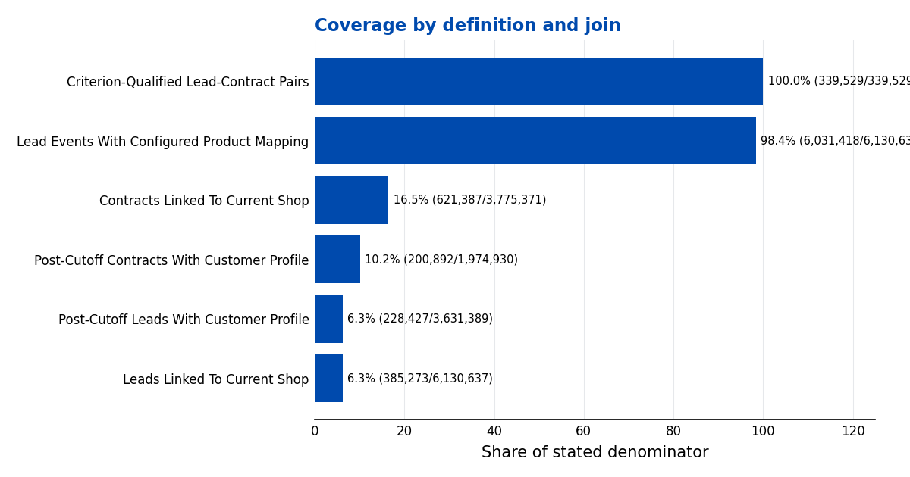
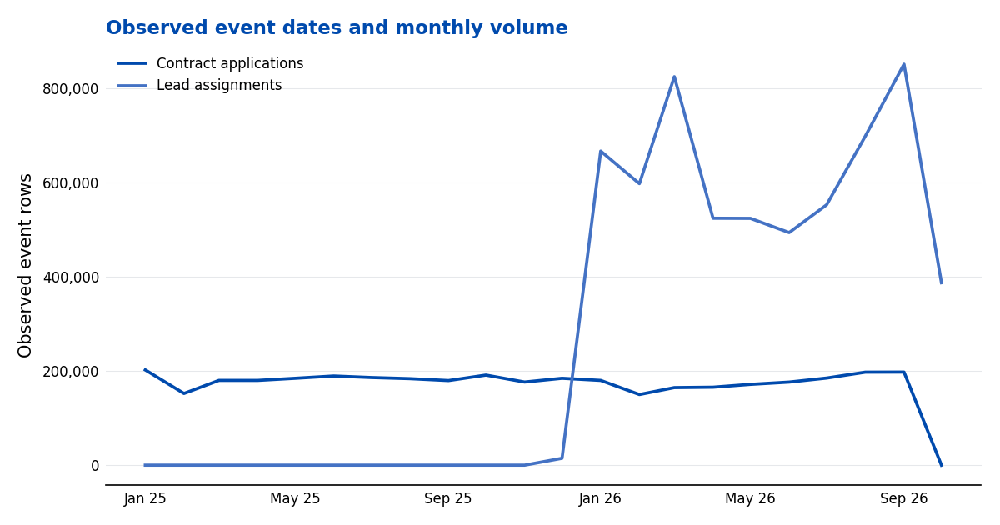
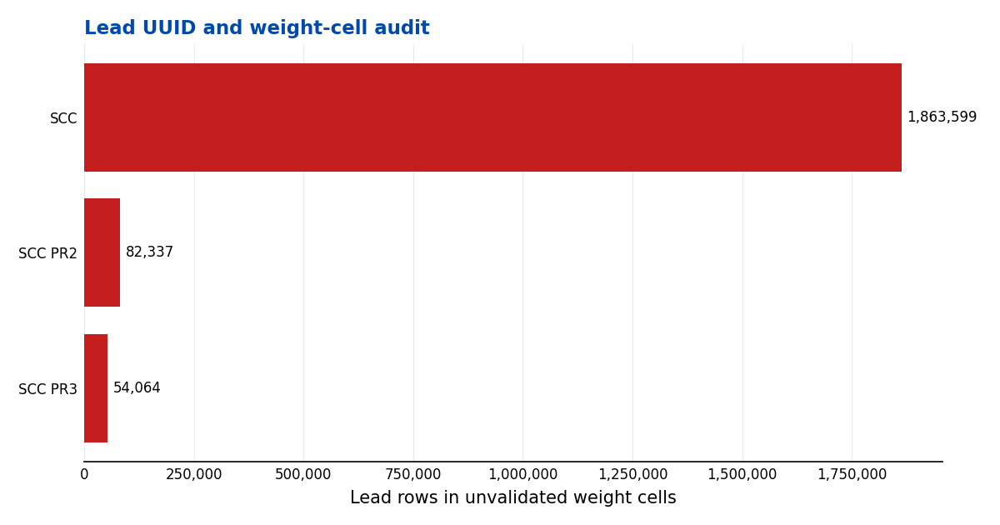
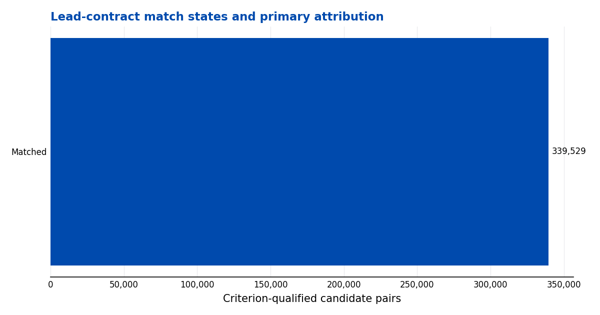
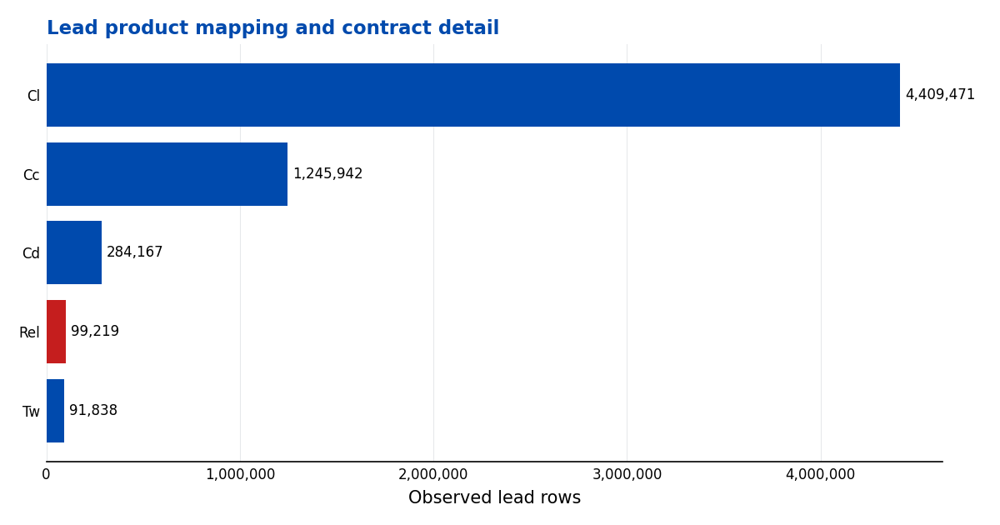
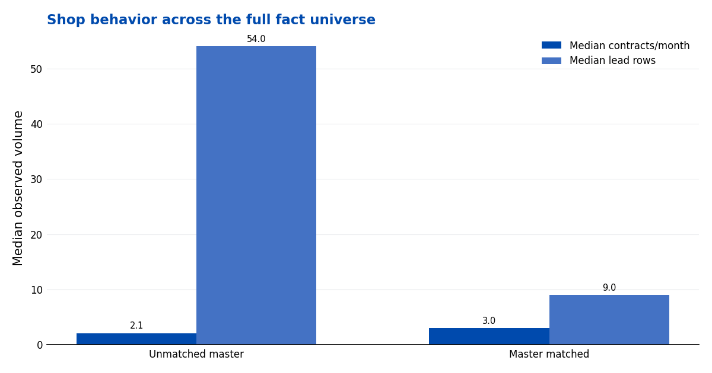
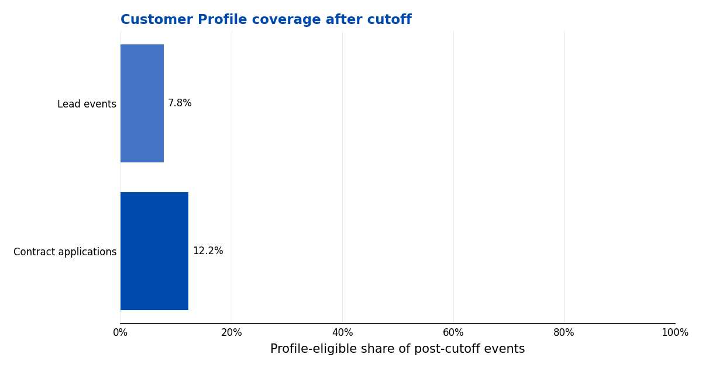
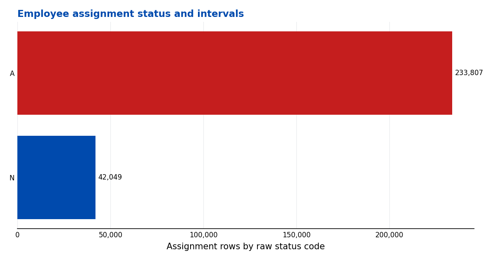
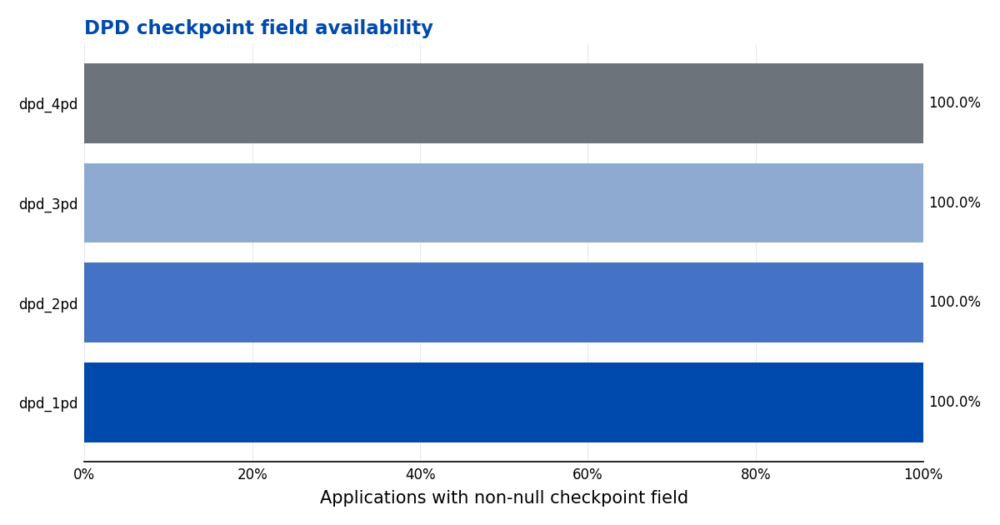

# BI10 Round 3 — Phase 2 EDA

## FND_01

**Insight:** Shop attribution is incomplete; configured product and date rules yield confirmed primary attribution.

**Evidence:** Current-master coverage: contracts 16.5%; leads 6.3%. Confirmed pairs 339,529; primary matches 260,674.

**Implication:** Keep unmatched shop IDs visible and state denominators for every comparison.

**Limitations:** Current master is a snapshot; exact product mappings are competition assumptions.

## FND_02

**Insight:** Contract and lead event windows differ, and sentinel dates are not valid event dates.

**Evidence:** 1,048,871 date-field values are missing, invalid or sentinel. Round 2 common cutoff: 2025-06-05.

**Implication:** Use complete observed periods and keep gaps distinct from zero activity.

**Limitations:** Date validity does not establish outcome maturity.

## FND_03

**Insight:** Repeated UUIDs and the concentrated weight cell affect lead-row interpretation.

**Evidence:** 208,990 repeated UUID groups span 417,981 rows. 2,000,000 rows have weight >1, concentrated in SCC / SCC PR2 / SCC PR3; weights remain QA-only.

**Implication:** Report raw events and unique UUIDs separately; do not interpret weights as population totals.

**Limitations:** UUID version semantics and the weight estimator remain unresolved.

## FND_04

**Insight:** Primary attribution credits each confirmed contract once; excess pairs mostly link distinct UUIDs.

**Evidence:** 339,529 confirmed pairs; 260,674 primary matches; 78,855 nonprimary pairs (417 same UUID, 78,438 different UUID). Lag buckets: 91+ days 81,498; 31–90 days 61,548; 1–7 days 29,913; Same day 129,919; 8–30 days 36,651.

**Implication:** Conversion denominators need a declared lead event/UUID grain, not candidate-pair counts; matched credit amounts remain raw application amounts.

**Limitations:** Repeated UUID rows remain undeduplicated because their event/version meaning is unknown.

## FND_05

**Insight:** TW, CL, CC and CD use configured exact-code mappings; REL remains unmapped.

**Evidence:** Configured-compatible lead rows 6,031,418; contract detail rows 784,902.

**Implication:** Show product codes and map scope in product comparisons.

**Limitations:** These four mappings are competition assumptions, not owner-validated compatibility.

## FND_06

**Insight:** The shop behavior profile includes fact shops with and without master attributes.

**Evidence:** Matched shops 12,412; unmatched 18,293. Median contracts/month: 3.00 vs 2.10.

**Implication:** Use these as descriptive peer context, not causal capacity or future potential.

**Limitations:** Unmatched attributes remain unknown; current master is not historical.

## FND_07

**Insight:** Round 2 Customer Profile labels cover a subset of post-cutoff events.

**Evidence:** Contract events eligible 348,440/2,845,138 (12.2%); leads 477,921/6,130,637 (7.8%); cutoff 2025-06-05.

**Implication:** Report event and distinct-customer denominators separately.

**Limitations:** Feature timestamp lineage and representativeness remain unverified.

## FND_08

**Insight:** Code A contributes a provisional active-assignment proxy.

**Evidence:** Configured active-status assignment rows 233,807; overlapping intervals 1,428.

**Implication:** Treat assignments as administrative coverage, not FTE or selling capacity.

**Limitations:** Code A is provisional and interval overlaps remain visible.

## FND_09

**Insight:** DPD fields are populated, but checkpoint maturity is unknown.

**Evidence:** Dated applications 3,775,371; non-null checkpoint values: dpd_1pd 3,775,371; dpd_2pd 3,775,371; dpd_3pd 3,775,371; dpd_4pd 3,775,371. Status snapshot: funded-origin 71.94%, rejected 15.0%, cancelled 13.1%, written off 1.7% of all contracts.

**Implication:** Do not interpret field presence as a default rate or matured outcome.

**Limitations:** Checkpoint timing, extract date and follow-up duration are undocumented.
