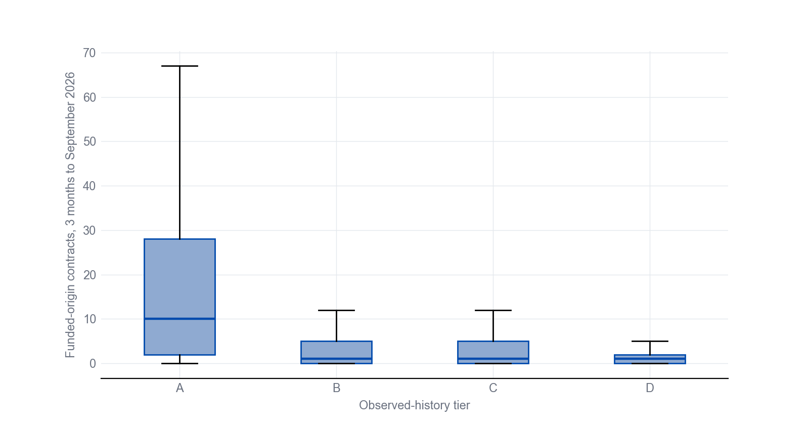
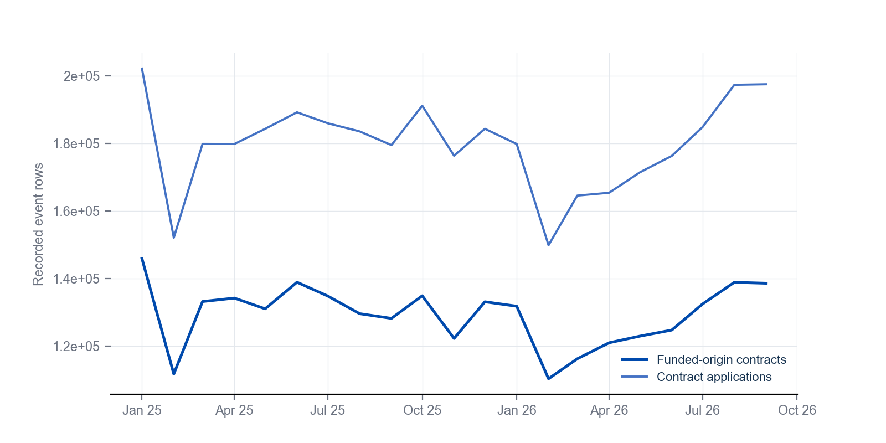
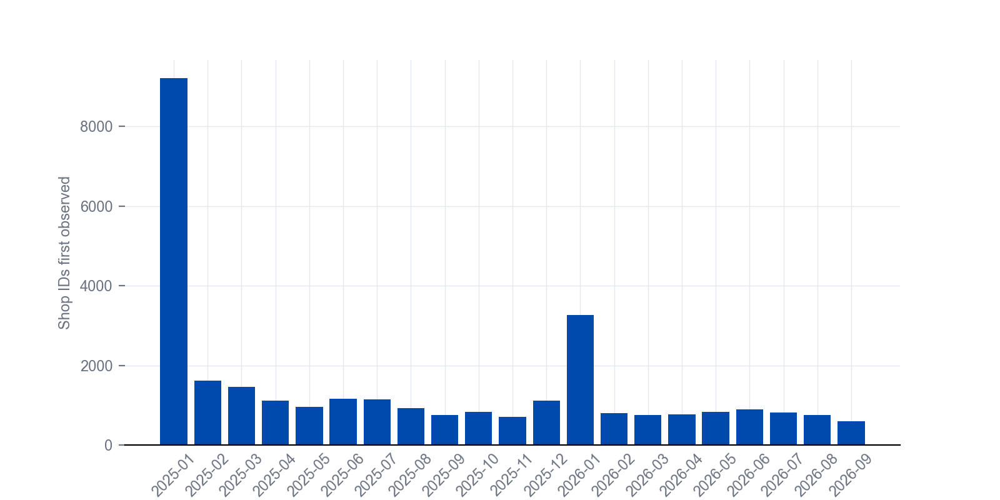
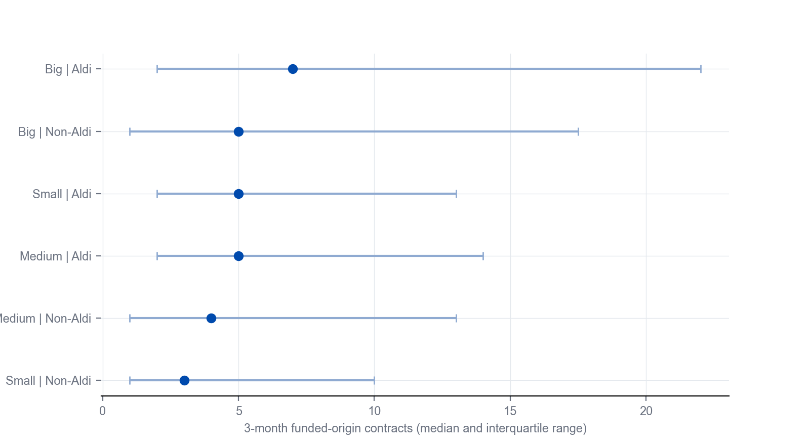
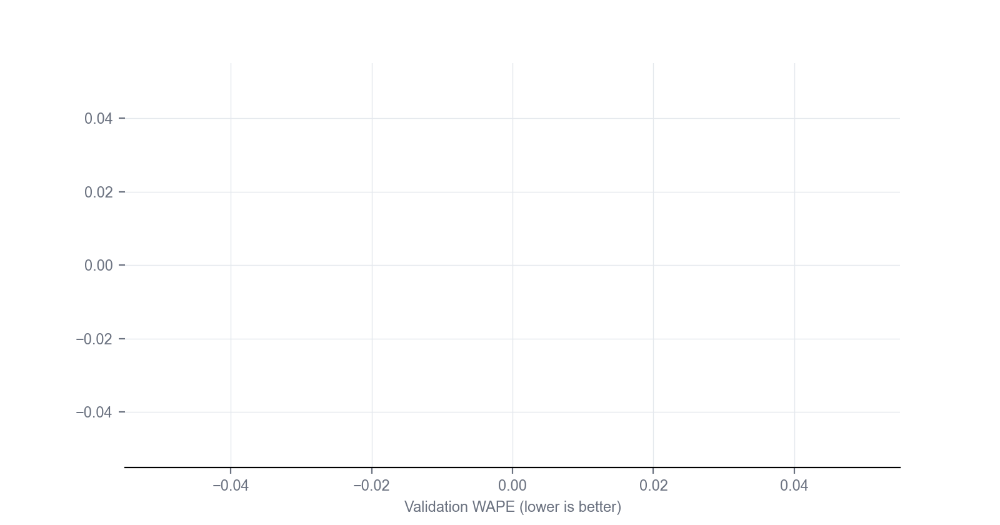
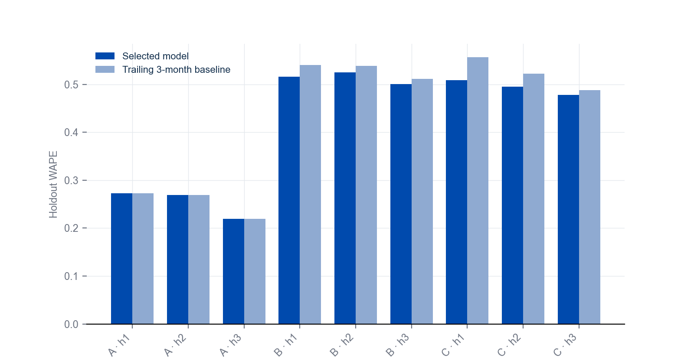
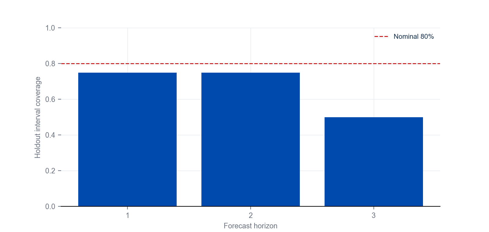
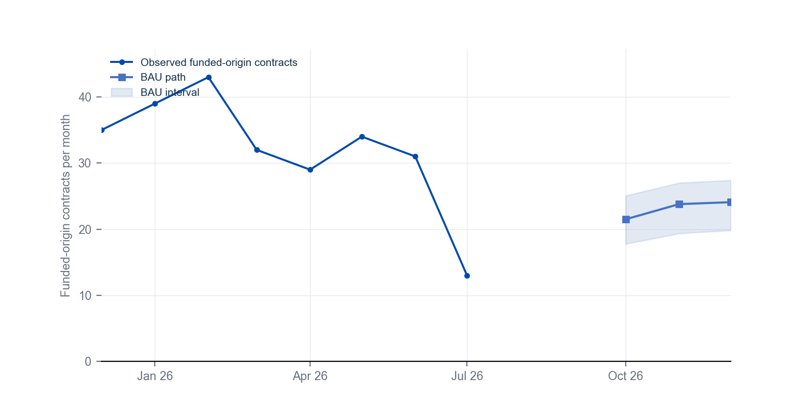
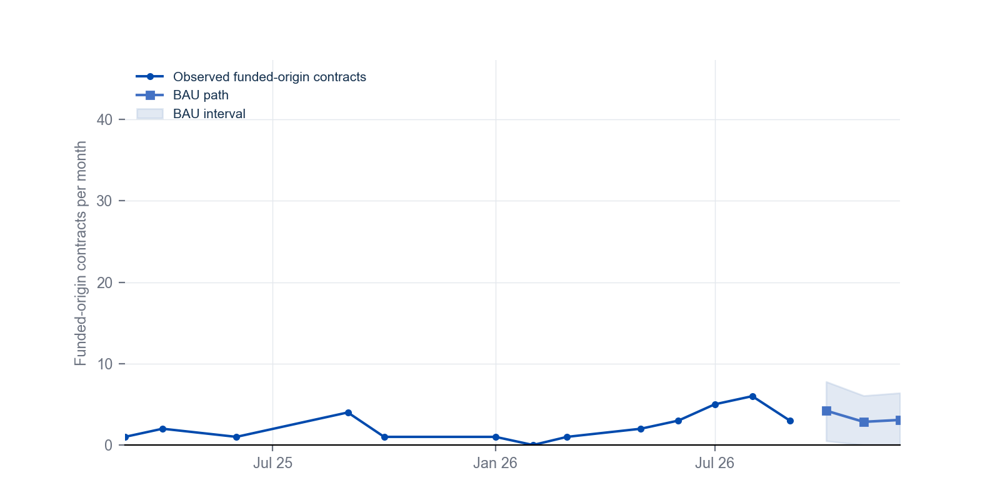

# Task 1 — Shop performance and BAU

## T1_01_Current_Actual_Baseline

**Insight:** Current observed activity differs strongly across history tiers.

**Evidence:** Median 3-month funded-origin actual for tier A is 10 contracts; tier D median is 1.

**Implication:** Forecast capability must be reported by tier rather than as one network number.

**Limitations:** Funded-origin is the contest assumption A01; raw application volume is a separate outcome.

## T1_02_Monthly_Shop_Trends

**Insight:** Monthly activity moved through a clear expansion and later slowdown.

**Evidence:** Window covers January 2025 to September 2026; last complete month has 138,645 funded-origin contracts and 197,495 applications.

**Implication:** Forecast origins must respect the difference between record volume and funded-origin volume.

**Limitations:** Monthly sums include recorded rows only; missing shop-months are not zero.

## T1_03_Shop_Lifecycle_Cohorts

**Insight:** Most shops enter the observed window early, with a smaller later cohort.

**Evidence:** Largest cohort is 2025-01 with 9,208 shops.

**Implication:** History-based tiers are required because lifecycle length is highly uneven.

**Limitations:** First observed month is an extract artefact, not a verified opening date.

## T1_04_Comparable_Shop_Benchmark

**Insight:** Peer groups differ in both level and dispersion of current activity.

**Evidence:** 6 supported peer groups shown; top group contains 5,133 shops.

**Implication:** Comparisons should stay within a supported category-model peer group.

**Limitations:** Peer definitions use current snapshot attributes and observed-tier membership.

## T1_05_Forecast_Model_Ladder

**Insight:** Transparent baselines are competitive; the selected model is tier-specific.

**Evidence:** Tier A horizon 1 selects recent_3m; best validation WAPE is nan.

**Implication:** Model choice is justified by out-of-sample error, not complexity.

**Limitations:** Validation evidence is short-history and tier-specific.

## T1_06_Rolling_Origin_Backtest

**Insight:** Model advantage over the trailing baseline exists in some tier-horizon cells only.

**Evidence:** Selected model beats the trailing baseline in 9 of 9 tier-horizon cells.

**Implication:** Where the baseline wins, BAU should be reported as a trailing reference.

**Limitations:** Holdout origins are few; WAPE differences are noisy.

## T1_07_Forecast_Interval_Calibration

**Insight:** Intervals are built from validation residuals and checked on later origins.

**Evidence:** Holdout coverage ranges from 0.50 to 0.75.

**Implication:** Wide intervals should accompany fallback and short-history tiers.

**Limitations:** Residual quantiles are tier-level, not shop-specific.

## T1_08A_Shop_Actual_vs_BAU

**Insight:** similar today, different BAU trajectory

**Evidence:** Shop 115096693: 3-month actual 13; BAU 3M total 69 (interval 62 to 75).

**Implication:** Similar current volume does not imply the same forward trajectory.

**Limitations:** The pair is selected on pre-origin evidence; contrasts are observed, not causal.

**Pair evidence:** Pair 115096693::99546349 selected with rule A05_SIMILAR_ACTUAL_10PCT (tolerance ±10%).

## T1_08B_Shop_Actual_vs_BAU

**Insight:** similar today, different BAU trajectory

**Evidence:** Shop 99546349: 3-month actual 14; BAU 3M total 10 (interval 3 to 16).

**Implication:** Similar current volume does not imply the same forward trajectory.

**Limitations:** The pair is selected on pre-origin evidence; contrasts are observed, not causal.

## Scope

Descriptive and BAU only. No attainable potential, ranking, recommendation or causal effect is produced.
Funded-origin contracts follow contest assumption A01; application volume is a demand indicator.
Assigned headcount is a descriptive assignment count (A11), never FTE and never a forecast feature.
Sample weights are not used. No-event shop-months remain missing rather than zero demand.
